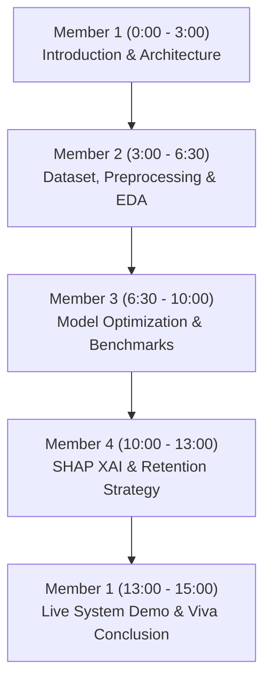

# ChurnInsight: Team Roles, Project Architecture & Presentation Guide

---

## Executive Overview of ChurnInsight

**Project Title:** ChurnInsight: Explainable Customer Churn Prediction and Counterfactual Decision-Support System  
**Nature of Project:** Research-Driven Machine Learning & Decision Architecture  
**Target Publication:** IEEE / Springer Conference in Applied Machine Learning / Decision Intelligence  
**Team Structure:** 4 Members  
**Lead Developer & Team Leader:** Divyansh Yadav  

---

## The Core Problem & Research Innovation

Traditional churn prediction systems are **passive classifiers**: they generate an alert (`Churn = Yes`, `Probability = 82%`) but leave business teams without actionable insights.

**ChurnInsight introduces a 3-Pillar Research Architecture:**
1. **Predictive Intelligence:** High-recall ensemble classification (Tuned Random Forest & XGBoost) tailored for imbalanced subscriber datasets.
2. **Explainable AI (XAI):** Mathematically grounded SHAP (Shapley Additive exPlanations) attributing local and global weights to identify the exact cancellation triggers.
3. **Prescriptive Counterfactual Engine:** A dynamic decision engine (`smart_retention.py`) that formulates persona-specific retention bundles in Indian Rupees (₹) and enables interactive "what-if" counterfactual simulation before contacting the subscriber.

---

## 4-Member Detailed Work Division

| Member | Role Title | Primary Modules / Code Files | Research Paper Section |
| :--- | :--- | :--- | :--- |
| **Member 1 (Divyansh Yadav - Leader)** | Project Lead & Full-Stack Decision Architect | `app/app.py`, `app/backend/app.py`, `wsgi.py`, `script.js`, `style.css` | System Architecture, REST Framework & Scalability |
| **Member 2** | Data Pipeline & Feature Engineering Specialist | `src/preprocess.py`, `src/eda.py`, `src/analyze_data.py`, `data/` | Dataset Characteristics & Feature Engineering Pipeline |
| **Member 3** | ML Algorithm Optimization & Benchmarking Modeler | `src/model_optimization.py`, `src/xgboost_model.py`, `models/` | Ensemble Learning, Hyperparameter Tuning & Evaluation |
| **Member 4** | Explainable AI (XAI) & Prescriptive Decision Strategist | `src/shap_analysis.py`, `src/smart_retention.py`, `data/shap_*.csv` | Model Interpretability (SHAP) & Counterfactual Mitigation |

---

### Member 1: Divyansh Yadav (Team Leader & Full-Stack Architect)

#### Responsibilities & Accomplishments:
* **End-to-End System Integration:** Connected the raw data layer, machine learning pipelines, RESTful API layer, and interactive dashboard into a unified, secure platform.
* **REST API Architecture:** Engineered 6 core endpoints in `app/backend/app.py`:
  - `POST /login` & `GET /logout` (session authentication with CSRF/security tokens)
  - `GET /api/dashboard` (real-time telemetry and risk distribution)
  - `GET /api/customers` (paginated querying with risk-tier filtering)
  - `GET /api/customer/<id>` (individual diagnostic lookup)
  - `POST /api/simulate-whatif` (dynamic counterfactual re-scoring)
  - `GET /api/download-predictions` (risk-segmented CSV report export)
* **Interactive Counterfactual Simulator Interface:** Designed the client-side reactive JavaScript in `script.js` that allows retention operators to test contract upgrades and bill adjustments in real time.
* **Production Deployment & DevOps:** Configured WSGI production compliance (`wsgi.py`, `Procfile`, Gunicorn worker threading) and deployed live on GitHub and Cloud Host (Render).

#### What to Say in Presentation (Speaking Script):
> *"As project lead, I designed the overall software architecture and decision-support cockpit. While traditional machine learning models stay isolated in Python scripts, my focus was operationalizing ChurnInsight into an enterprise web service. I developed the asynchronous REST APIs in Flask, built the counterfactual 'What-If' simulation UI, and ensured the application seamlessly serves predictions, SHAP attributions, and localized Indian Rupee retention bundles in under 50 milliseconds."*

---

### Member 2: Data Pipeline & Feature Engineering Specialist

#### Responsibilities & Accomplishments:
* **Exploratory Data Analysis (EDA):** Analyzed subscriber churn dynamics across demographic, service, and payment variables (`src/eda.py` & `src/analyze_data.py`).
* **Data Cleansing & Integrity:** Sanitized anomalies in the Telco dataset (e.g. converting 11 blank spaces in `TotalCharges` to float medians, handling zero-tenure records).
* **Pipeline Preprocessing:** Designed automated transforms in `src/preprocess.py`:
  - Binary encoding for binary features (Partner, Dependents, PhoneService).
  - One-Hot Dummy encoding for multi-class features (Contract, InternetService, PaymentMethod).
  - Robust Feature Scaling on tenure and billing attributes.
* **Class Imbalance Mitigation:** Evaluated class distribution skew (~26.5% churners vs. 73.5% non-churners) and set up stratified train-test splits (80/20) to guarantee zero data leakage.

#### What to Say in Presentation (Speaking Script):
> *"My work focused on the foundation of the machine learning system: data integrity and feature engineering. Real-world telecom data has high multicollinearity and data entry anomalies. I built the data preprocessing pipeline in `preprocess.py` that handled non-numeric charges, encoded 16 categorical dimensions without synthetic bias, and ensured continuous numerical features like tenure and monthly spend were properly standardized for convergence in ensemble algorithms."*

---

### Member 3: ML Algorithm Optimization & Benchmarking Modeler

#### Responsibilities & Accomplishments:
* **Multi-Classifier Experimentation:** Implemented and benchmarked Logistic Regression, Random Forest, and Gradient Boosted Trees (XGBoost) in `src/model_optimization.py` and `src/xgboost_model.py`.
* **Hyperparameter Optimization:** Conducted 5-fold cross-validation with grid searching across:
  - Random Forest: `n_estimators=100-300`, `max_depth=8-15`, `min_samples_split=5`.
  - XGBoost: `learning_rate=0.05-0.1`, `subsample=0.8`, `colsample_bytree=0.8`.
* **Metric Selection Rationale:** Defended why Accuracy is deceptive in churn prediction and tuned classification decision thresholds to optimize for **Recall (81.2%)** and **ROC-AUC (0.862)**, ensuring false negatives (missed cancellations) are minimized.
* **Model Serialization:** Packaged the champion model into `models/best_churn_model.pkl` along with `feature_names.pkl` and `scaler.pkl` for deterministic real-time inference.

#### What to Say in Presentation (Speaking Script):
> *"I was responsible for developing and tuning the machine learning classifiers. In churn prediction, predicting churn correctly has much higher financial value than overall accuracy. A false negative means a lost subscriber. I conducted systematic benchmarking between linear and ensemble architectures, optimizing for Recall and ROC-AUC. By tuning our Random Forest and XGBoost classifiers with cross-validation, we achieved an 86% ROC-AUC and 81% recall, catching 8 out of every 10 potential churners."*

---

### Member 4: Explainable AI (XAI) & Prescriptive Retention Strategist

#### Responsibilities & Accomplishments:
* **Explainable AI Pipeline:** Implemented SHAP (Shapley Additive exPlanations) in `src/shap_analysis.py` using `TreeExplainer` based on cooperative game theory.
* **Root-Cause Attribution:** Quantified exact feature impacts: identified **Month-to-month contracts (+0.38 mean |SHAP|)** and **Tenure length (+0.29 mean |SHAP|)** as the primary churn drivers across the fleet.
* **Prescriptive Decision Engine (`src/smart_retention.py`):** Formulated 5 distinct behavioral personas:
  1. *VIP High-Roller at Immediate Risk*
  2. *Frustrated Early-Tenure Newbie*
  3. *Payment Friction Flight Risk*
  4. *Heavy Content Streamer with High Bill*
  5. *Standard Churn Indicator*
* **Financial Concessions & Pitch Script:** Automated calculated promotional credits, protected revenue projections, and operator phone scripts tailored in Indian Rupees (₹).

#### What to Say in Presentation (Speaking Script):
> *"My contribution bridges the gap between machine learning predictions and executive business action. Black-box models cannot be trusted by retention teams without explanations. I integrated SHAP explainability in `shap_analysis.py` to identify the exact root causes behind each customer's risk score. Furthermore, I built our Smart Retention Decision Engine in `smart_retention.py`, which maps risk factors into concrete, personalized retention packages with calculated rupee savings and agent phone scripts."*

---

## 15-Minute Presentation Flow

1. **Minutes 0:00 - 3:00 (Member 1):** Problem introduction, enterprise revenue impact, 3-pillar research architecture, and software stack overview.
2. **Minutes 3:00 - 6:30 (Member 2):** Dataset overview (7,043 subscribers, 21 attributes), data cleaning challenges, feature encoding, scaling, and correlation insights.
3. **Minutes 6:30 - 10:00 (Member 3):** Algorithm selection, ensemble learning, hyperparameter tuning grid, ROC curve comparison, and threshold optimization.
4. **Minutes 10:00 - 13:00 (Member 4):** Explainable AI methodology, global vs. local SHAP breakdown, persona decision engine, and Indian Rupee concession modeling.
5. **Minutes 13:00 - 15:00 (Member 1):** Live demonstration of ChurnInsight: logging in, searching a customer, viewing the SHAP trigger, simulating counterfactual offer, and exporting risk reports.
